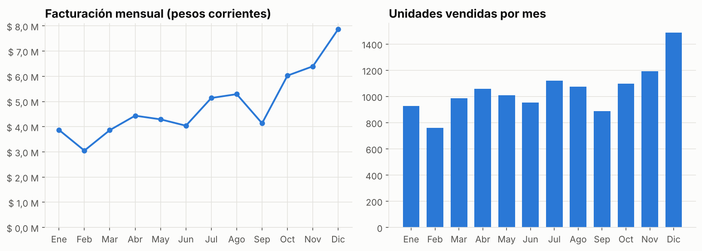
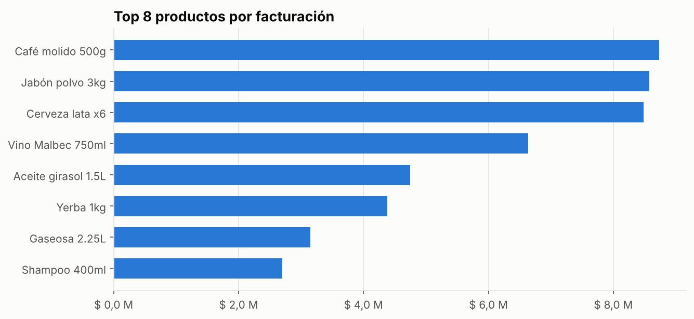
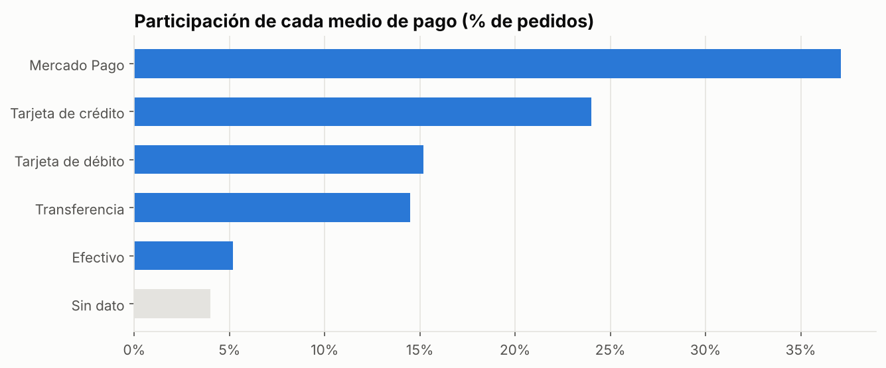

# Pipeline de limpieza y dashboard de ventas — e-commerce argentino

[](https://github.com/SpixeBR/proyecto-1-limpieza-ventas/actions/workflows/tests.yml)
🇬🇧 [Read in English](README.md)

> **Caso de portfolio con datos simulados.** La empresa y los datos son ficticios, pero reproducen los problemas reales de una exportación de ventas de un e-commerce.



## El problema

Un e-commerce de almacén con ventas en 9 provincias quiere saber cuánto vende realmente, dónde y cuándo. Su exportación de ventas de 2025 no permite responderlo:

| Problema | Ejemplo | Consecuencia |
|---|---|---|
| Pedidos duplicados | 120 filas repetidas | Ventas contadas dos veces |
| Totales que perdieron la coma decimal | Yerba 1kg por $ 504.221 (eran $ 5.042,21) | Facturación inflada un 7% |
| Cantidades imposibles | -2, 0 | Unidades mal calculadas |
| Fechas en 4 formatos | `2025-08-02`, `24/08/2025`, `20/08/25` | No se puede agrupar por mes |
| Montos como texto | `$ 18.336,70` mezclado con `14355.31` | No se puede sumar |
| Nombres inconsistentes | `Bs As`, `BUENOS AIRES`, `Capital Federal` | Una provincia aparece como cinco |

## La solución

1. **Pipeline de limpieza automatizado** (`src/limpiar_datos.py`): un script reutilizable que se corre con un comando cada vez que llega una exportación nueva. Cada paso queda registrado en un log que explica qué se cambió y por qué.
2. **Tests automáticos** (`tests/`) que verifican cada regla de limpieza.
3. **Análisis exploratorio** (`notebooks/analisis_ventas.ipynb`) que usa el pipeline y documenta los hallazgos.
4. **Dashboard interactivo** en Streamlit (`app.py`) con filtros por período y provincia.
5. **Resumen ejecutivo** de una página para el dueño del negocio (`docs/resumen_ejecutivo.pdf`).

### Decisiones de limpieza

| Situación | Decisión | Por qué |
|---|---|---|
| Cantidad 0 o negativa | Se excluye el pedido | No hay forma segura de saber la cantidad real |
| Total ≠ precio × cantidad | Se compara cada valor con el precio habitual del producto y se corrige el que está fuera de rango | Así se detecta si el error está en el total o en el precio, en vez de asumirlo |
| Precio faltante | Se calcula como total ÷ cantidad (salvo que el resultado sea imposible) | Es un dato derivable, no un invento |
| Provincia o medio de pago faltante | Se marca como `Sin dato` | Imputar una provincia falsearía el análisis geográfico |
| Cliente faltante | Se conserva el pedido | La venta existió; solo afecta el conteo de clientes |

## Resultados

De 5.120 registros quedan **4.975 pedidos válidos**. Los datos sin limpiar inflaban la facturación anual un 7%, por apenas 8 totales mal cargados.

1. **Diciembre es el mes clave:** se vendió un 48% más de unidades que el promedio del resto del año. La facturación se duplicó de enero a diciembre, pero buena parte es aumento de precios, así que el crecimiento real se mide en unidades.
2. **Pocos productos explican gran parte de la facturación:** café, jabón en polvo y cerveza lideran, y Almacén y Bebidas suman el 70% de los ingresos.
3. **Mercado Pago domina:** 37% de los pedidos, con un ticket promedio similar al de los demás medios.

Además, Buenos Aires, CABA y Córdoba concentran el 68% de la facturación, y de viernes a domingo entran un 24% más de pedidos por día.

<p>
  
  
</p>

## Cómo usarlo

Requiere Python 3.12 o superior (las dependencias están fijadas a las versiones probadas con Python 3.14).

```bash
git clone https://github.com/SpixeBR/proyecto-1-limpieza-ventas.git
cd proyecto-1-limpieza-ventas
python -m venv .venv
source .venv/bin/activate          # en Windows: .venv\Scripts\activate
pip install -r requirements.txt
```

| Para… | Ejecutar |
|---|---|
| Limpiar una exportación | `python src/limpiar_datos.py data/raw/ventas_crudas.csv data/processed/ventas_limpias.csv --log data/processed/log_limpieza.csv` |
| Correr los tests | `pytest -q` |
| Abrir el dashboard | `streamlit run app.py` |
| Ver el análisis | `jupyter notebook notebooks/analisis_ventas.ipynb` |
| Regenerar el resumen PDF | `python src/generar_resumen_pdf.py` |
| Regenerar los datos simulados | `python src/generar_datos.py` |

## Estructura

```
├── app.py                         # dashboard en Streamlit
├── data/
│   ├── raw/ventas_crudas.csv      # exportación original (sucia)
│   └── processed/                 # datos limpios + log de limpieza
├── docs/resumen_ejecutivo.pdf     # resumen para el dueño del negocio
├── figures/                       # gráficos del análisis
├── notebooks/analisis_ventas.ipynb
├── src/
│   ├── limpiar_datos.py           # pipeline de limpieza (CLI + funciones)
│   ├── generar_resumen_pdf.py     # arma el resumen ejecutivo desde los datos
│   └── generar_datos.py           # crea los datos simulados
├── tests/test_limpiar_datos.py
└── requirements.txt
```

**Herramientas:** Python, pandas, NumPy, matplotlib, Plotly, Streamlit, pytest, ReportLab, Jupyter.
