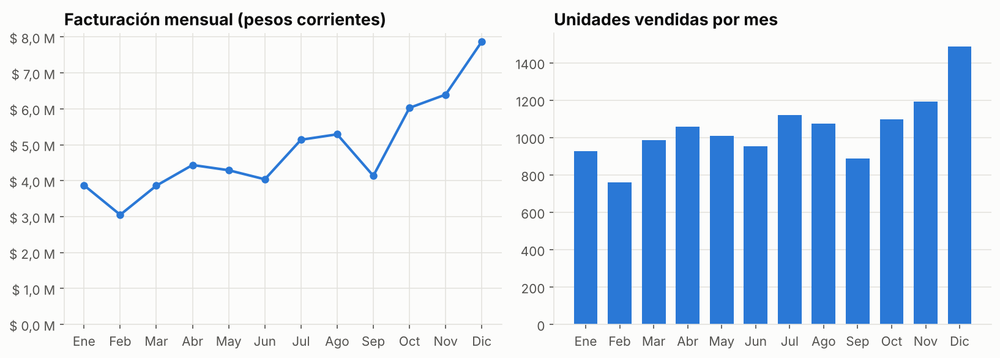
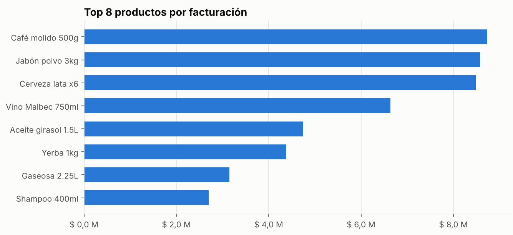
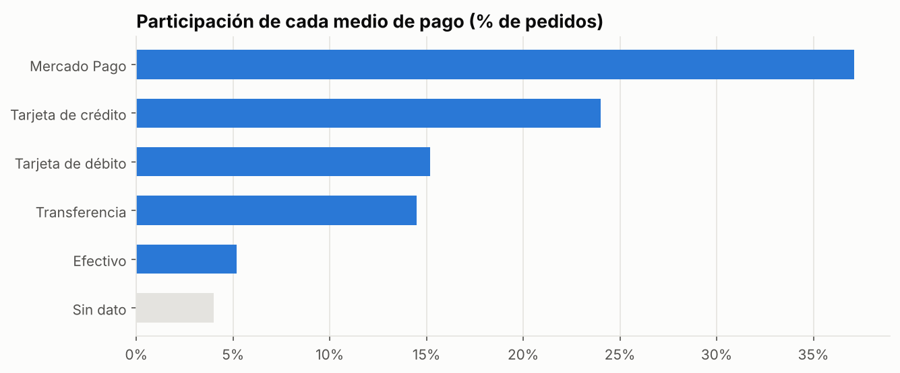

# Sales Data Cleaning Pipeline & Dashboard — Argentine E-commerce

🇪🇸 [Leer en español](README.es.md)

> **Portfolio project using simulated data.** The company and the data are fictional, but they reproduce the real-world problems of a messy e-commerce sales export.



## The problem

An online grocery store selling in 9 provinces wants to know how much it really sells, where and when. Its 2025 sales export can't answer that:

| Issue | Example | Impact |
|---|---|---|
| Duplicate orders | 120 repeated rows | Sales counted twice |
| Totals that lost the decimal comma | Yerba 1kg for $504,221 (should be $5,042.21) | Revenue inflated by 7% |
| Impossible quantities | -2, 0 | Wrong unit counts |
| Dates in 4 formats | `2025-08-02`, `24/08/2025`, `20/08/25` | Can't group by month |
| Amounts stored as text | `$ 18.336,70` mixed with `14355.31` | Can't be summed |
| Inconsistent names | `Bs As`, `BUENOS AIRES`, `Capital Federal` | One province appears as five |

## Dataset

Synthetic data generated by [`src/generar_datos.py`](src/generar_datos.py) with a fixed random seed, so it is fully reproducible: 5,120 raw order rows for 2025 with deliberately injected errors. It is **not** a public dataset, so there is nothing to download: the raw export is included in [`data/raw/ventas_crudas.csv`](data/raw/ventas_crudas.csv) (~470 KB). Column names, categories and product names are in Spanish.

## The solution

1. **Automated cleaning pipeline** (`src/limpiar_datos.py`): a reusable CLI script to run whenever a new export arrives. Every step is written to a log that explains what changed and why.
2. **Automated tests** (`tests/`) covering each cleaning rule.
3. **Exploratory analysis** (`notebooks/analisis_ventas.ipynb`) built on the pipeline, documenting the findings.
4. **Interactive Streamlit dashboard** (`app.py`) with period and province filters.
5. **One-page executive summary** for the business owner (`docs/resumen_ejecutivo.pdf`, in Spanish).

### Cleaning decisions

| Situation | Decision | Why |
|---|---|---|
| Quantity 0 or negative | Order is excluded | There is no safe way to know the real quantity |
| Total ≠ unit price × quantity | Each value is compared with the product's usual price and the one that is out of range is corrected | Detects whether the error is in the total or in the price instead of assuming |
| Missing unit price | Computed as total ÷ quantity (unless the result is impossible) | It is derivable data, not an invention |
| Missing province or payment method | Flagged as `Sin dato` | Imputing a province would distort the geographic analysis |
| Missing customer | Order is kept | The sale happened; it only affects the customer count |

## Key results

*Results refer to this simulated dataset.* Of 5,120 raw records, **4,975 valid orders** remain. The uncleaned data overstated annual revenue by 7%, because of only 8 mis-entered totals.

1. **December is the key month:** 48% more units sold than the average of the other months. Revenue doubled from January to December, but much of that is price increases, so real growth should be measured in units.
2. **A few products drive revenue:** coffee, laundry detergent and beer lead, and Grocery and Beverages together make up 70% of revenue.
3. **Mercado Pago dominates:** 37% of orders, with an average ticket similar to the other payment methods.

In addition, Buenos Aires, CABA and Córdoba concentrate 68% of revenue, and Friday–Sunday brings 24% more orders per day than Monday–Thursday.

<p>
  
  
</p>

## How to run

Requires Python 3.11 or higher (dependencies are pinned to the versions tested on Python 3.14).

```bash
git clone https://github.com/SpixeBR/proyecto-1-limpieza-ventas.git
cd proyecto-1-limpieza-ventas
python -m venv .venv
source .venv/bin/activate          # on Windows: .venv\Scripts\activate
pip install -r requirements.txt
```

| To… | Run |
|---|---|
| Clean an export | `python src/limpiar_datos.py data/raw/ventas_crudas.csv data/processed/ventas_limpias.csv --log data/processed/log_limpieza.csv` |
| Run the tests | `pytest -q` |
| Open the dashboard | `streamlit run app.py` |
| View the analysis | `jupyter notebook notebooks/analisis_ventas.ipynb` |
| Regenerate the PDF summary | `python src/generar_resumen_pdf.py` |
| Regenerate the simulated data | `python src/generar_datos.py` |

## Project structure

```
├── app.py                         # Streamlit dashboard
├── data/
│   ├── raw/ventas_crudas.csv      # original (dirty) export
│   └── processed/                 # clean data + cleaning log
├── docs/resumen_ejecutivo.pdf     # executive summary (Spanish)
├── figures/                       # analysis charts
├── notebooks/analisis_ventas.ipynb
├── src/
│   ├── limpiar_datos.py           # cleaning pipeline (CLI + functions)
│   ├── generar_resumen_pdf.py     # builds the executive summary from the data
│   └── generar_datos.py           # creates the simulated data
├── tests/test_limpiar_datos.py
└── requirements.txt
```

**Tools:** Python, pandas, NumPy, matplotlib, Plotly, Streamlit, pytest, ReportLab, Jupyter.

## License

[MIT](LICENSE)
